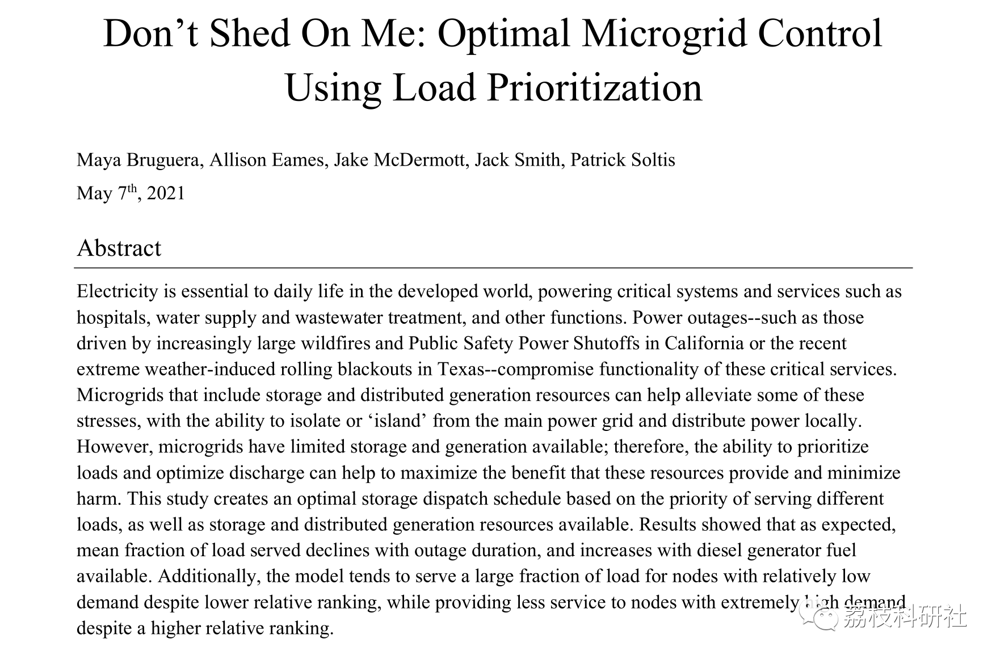
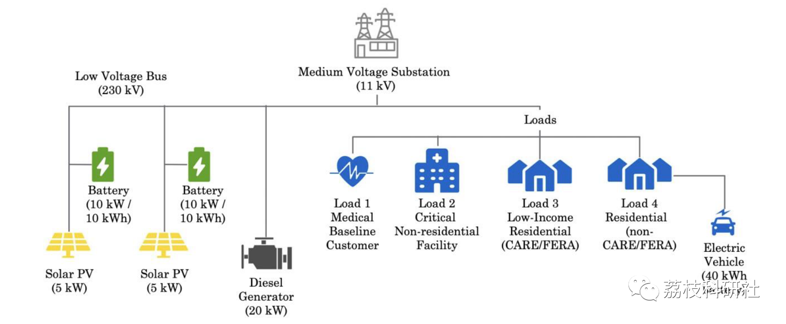
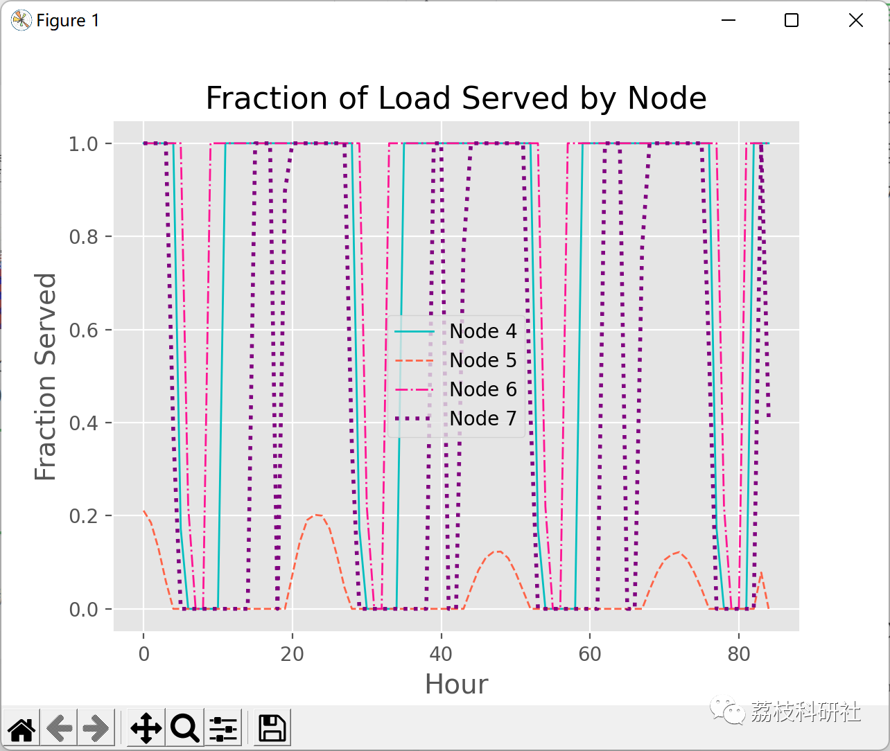
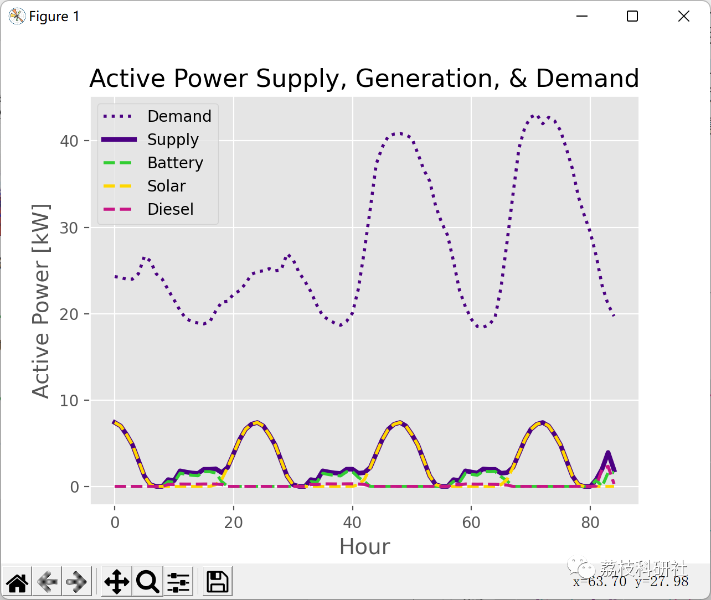
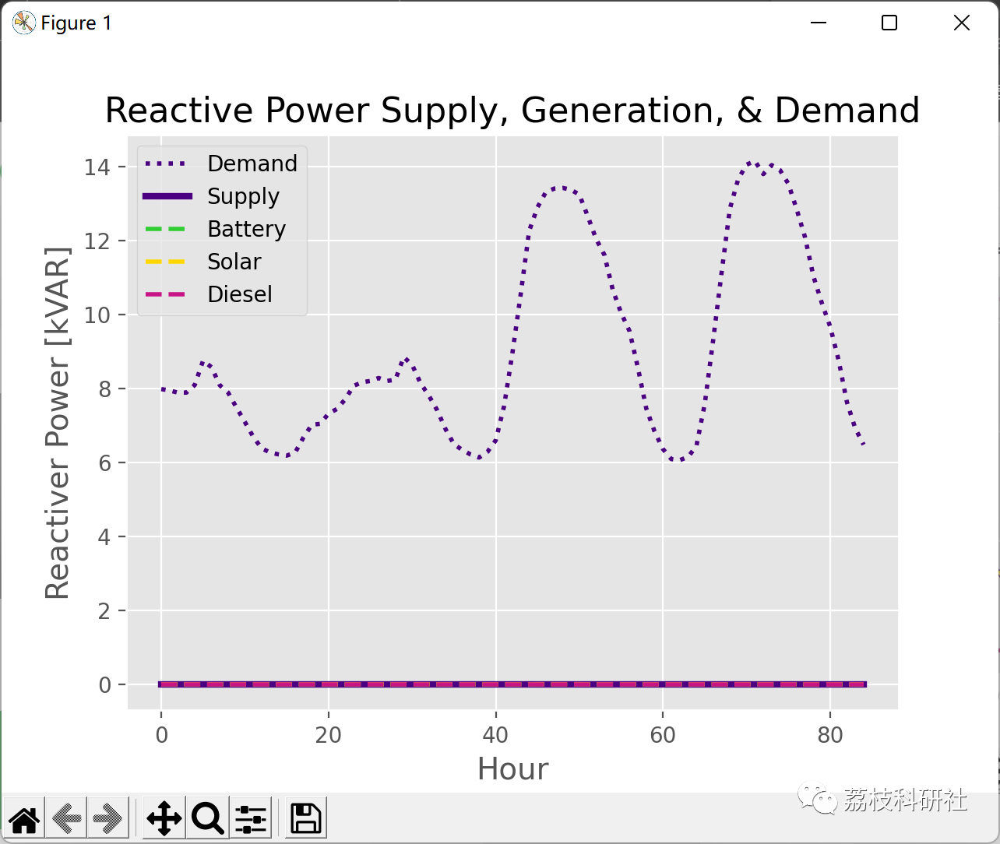
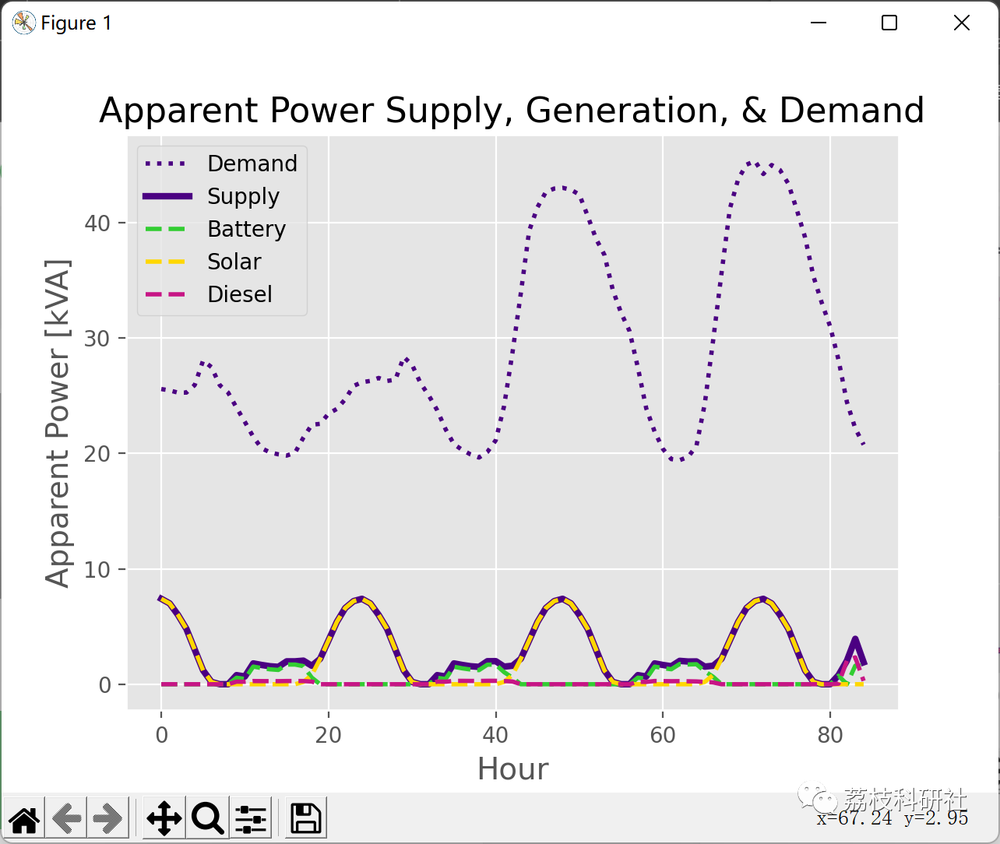
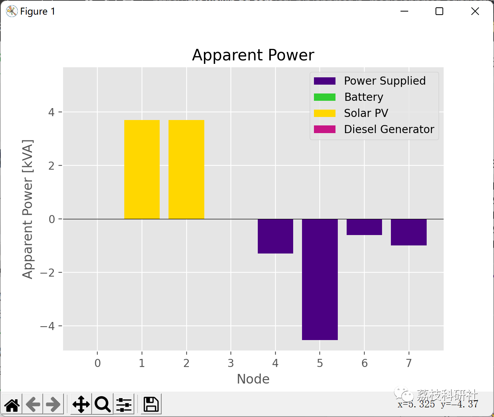
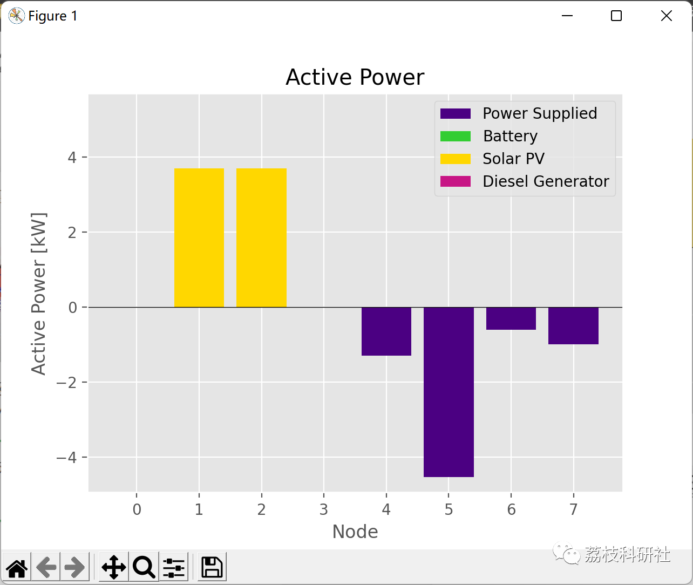
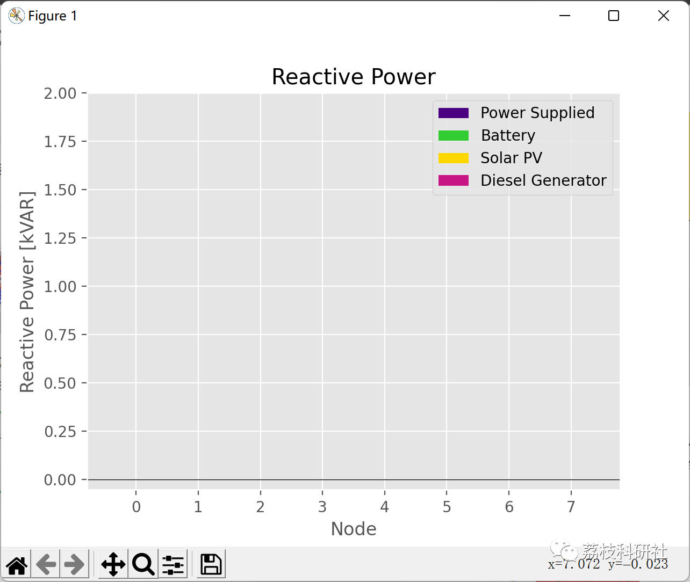

# Microgrid Optimized Dispatching (Light, Energy Storage, Diesel Engine) (Python Code Implementation)

💥💥💥💞💞💞 Welcome to this blog❤️❤️❤️💥💥💥
🏆 Bloggers' Advantages: 🌞🌞🌞 The content of the blog strives for rigorous thinking and clear logic to facilitate readers.
⛳️ Mantra: A journey of a thousand miles is half done in the ninetieth mile.
Litchi Research Society
Code Collection: Power Systems, Intelligent Algorithms and Applications, Neural Network Prediction, Path Planning, Optimized Scheduling, Workshop Scheduling, Image Processing, Signal Processing...
🎁 Special Section Links:
🌈🌈🌈🌟🌟🌟 Electrical Code Intelligent Algorithms and Their Applications Path Planning Neural Network Prediction Optimized Scheduling Image Processing Workshop Scheduling Signal Processing Romantic Her
Sources of literature, Python code reproduction:
💥1 Overview
Power is essential for daily life in developed countries, providing power for critical systems and services such as hospitals, water treatment, and wastewater treatment. Outages, such as those caused by California or recent wildfires and public safety outages in Texas, which are becoming increasingly severe due to extreme weather conditions, can disrupt these key services. Microgrids with storage and distributed generation resources can help mitigate some of these issues. Pressure, having the ability to isolate from the main grid or "islands" and distribute power locally. However, the limited availability of storage and distributed generation resources in microgrids makes it important to determine priorities for load and optimize emissions to maximize the benefits of these resources and minimize harm. This study creates optimal storage scheduling plans based on the priority of different service types, load, and available storage and distributed generation resources. The results show that as expected, the average proportion of service load decreases with the duration of the outage, and increases with the addition of diesel generator fuel. Moreover, the model tends to provide most of the load to relatively lower nodes despite their lower ranking, while providing less service to nodes with high demand despite their higher ranking.
📚2 Running Results
🎉3 References
🌈4 Python Code Implementation + Details + Data
Click the article's lower left corner to read more.

## Images

<!-- PAYMENT_BLOCK -->

## Get this dataset

- Payment link (Stripe): [Buy now](https://buy.stripe.com/3cs8yP7sY87d0vu9AB)
- Payment QR code: 

<!-- /PAYMENT_BLOCK -->
